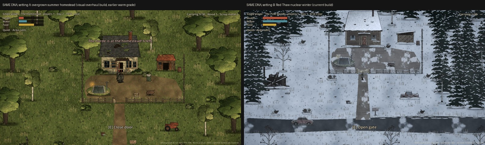
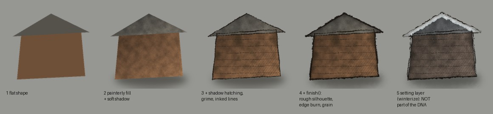

# Visual DNA — the "dirty ink" 2D look (extracted from Red Thaw)

**Status:** analysis of the *delivered* implementation on branch `iteration/010-red-thaw` @ `497d840`
(Godot 4.7.2, Compatibility renderer). Every value below was read from the files named in brackets. The
labels mean:

- **[VERIFIED]** — implemented and measured in the repository.
- **[INTERPRETATION]** — my reading of why it works; not a setting in the project.
- **[NOT IMPLEMENTED]** — intended or commonly assumed, but the project does **not** do it.

Setting-specific content (snow, pines, horror, blood) is **excluded** here. See
[`RED_THAW_SPECIFIC.md`](RED_THAW_SPECIFIC.md). Reproduction steps are in
[`GODOT_REPRODUCTION_GUIDE.md`](GODOT_REPRODUCTION_GUIDE.md).


*Left: the same pipeline before the winter conversion (a green summer homestead, from
`docs/screenshots/visual_overhaul/j6_horde_at_homestead.jpg`, rendered with an earlier, warmer grade).
Right: Red Thaw (`docs/screenshots/iteration_010/r04_frozen_pine_woods.jpg`). The linework, texture,
silhouettes, layering and finish are identical; only the palette, setting dressing and grade differ.
That is the proof that the DNA is portable.*

---

## 0. The look in one paragraph

The look is hand-inked, illustrated 2D sprites (never pixel art), seen from a **3/4 oblique top-down
camera**. Every object is a front-facing illustration standing on a flat textured ground plane and is
depth-sorted by its ground-contact point. Each sprite is a **painterly, mottled colour fill** with a
faint warm/cool hue drift and paper fibre. Shadow sides are **hatched with fine diagonal ink lines**.
Construction lines are **wobbly, width-varying, tapered brush-pen strokes** with a faint dry-brush
ghost. A finishing pass wraps the whole sprite in a **rough, broken ink silhouette** and burns its
inner edges darker. On screen, a single **full-screen grade** desaturates and adds contrast, split-tones
shadows and highlights, darkens the edges with a tinted vignette and adds paper grain. A slowly
drifting, world-anchored texture can veil the scene. Light sources are soft radial glows, and a global
`CanvasModulate` sets the time of day. **[VERIFIED]**

---

## 1. Illustration style and linework [VERIFIED]

Source: `tools/art/inkkit.py` (`Canvas`). All templates are drawn offline in Python (PIL + numpy)
at **2× supersampling** (`SS = 2`), then downsampled with Lanczos to the source size. The source size is
itself about 2× the in-game display size.

| Trait | How it is produced | Key values |
|---|---|---|
| Ink colour | One warm near-black, never pure black | `INK = (33, 27, 21)` |
| Brush-pen stroke (`ink()`) | The path is resampled every `seg` px. Each sample gets a perpendicular jitter (sine + random) × `wobble` and a width varying between 0.7× and 1.25× (sine + random 0.85–1.12) | defaults `width 2.0`, `wobble 0.9`, `alpha 235`, `seg 6` |
| Tapered ends | Open strokes taper over the first and last 20 % of their length | `w *= 0.45 + 0.55 * min(1, min(t, 1−t) * 5)` |
| Dry-brush ghost | When width ≥ 1.6 and alpha ≥ 150, a broken second pass at 38 % alpha and 45 % width, offset by (0.9, 0.7) px over a random third of the stroke, with 12 % gaps | adds hand-made unevenness |
| Outline weight hierarchy | Silhouettes and big shapes 2.2–3.6 px; secondary forms 1.4–2.0 px; texture lines (planks, folds, cracks) 0.8–1.4 px at alpha 110–200 | measured across `gen_*.py` |
| Translucency | Each stroke is drawn on its own layer and alpha-composited, so translucent ink *tints* what is under it | never punches holes |

**Silhouette design:**
- Shapes are irregular blobs and splines, never ruler-straight: `blob()` adds ±18 % radial noise, and
  `spline()` is Catmull-Rom.
- Figures are built from **tapered limb capsules** (`gen_figures.py: limb()`) and curved spline
  torsos, not boxes.
- Every sprite gets a strong outer contour from the finish pass (§3).

**[INTERPRETATION]** The look reads as "drawn by hand with a brush pen on cheap paper" because no line
is uniform, ends taper, and the contour is slightly broken.

---

## 2. Colour, saturation and tonal relationships [VERIFIED]

**Sprite level** (`Canvas.fill`). Every flat colour is turned into a mottled, painterly field:

```
shade  = 1 + (n − 0.5)·1.3·tex + (g − 0.5)·1.6·grain + (fibre − 0.5)·0.07
warmth = clamp((n2 − 0.5)·0.9 + lit, −1, 1)
rgb    = base·(1 − 0.45·w⁺ − 0.55·w⁻) + warm·0.45·w⁺ + cool·0.55·w⁻   then × shade
warm   = base·0.82 + (214,176,112)·0.18      cool = base·0.80 + (46,52,50)·0.20
```

- `n` is value noise at `cell`, and `n2` is value noise at 3× `cell`.
- `g` is white noise; `fibre` is 3 px noise.
- `lit` is an optional directional light `(dx, dy, strength)`: the lit side brightens and warms, and the
  far side darkens and cools. The usual setting is `light = (−1, −1, 0.3)`, light from the upper left.
- Typical `tex` is 0.25–0.4, with `cell` 5–12 px for small parts and 24–30 px for large surfaces.

**Tonal rules found in the art:**
1. Light comes from the **upper left** throughout. Shadow hatching sits on the lower right
   (`shade(mask, dx=1, dy=0.6)`).
2. Mid-tones are dominant. The darkest values are ink lines and openings (doorways about `#141210`), and
   the brightest values are rare highlights.
3. Colours are earthy and muted *before* the screen grade, and the grade then desaturates again (§6).
4. Each material keeps one base hue. Variation comes from value noise and the warm/cool drift, not from
   extra hues.

**Screen level:** global desaturation (saturation 0.7–0.85), mild S-curve contrast (1.08), split toning
and a tinted vignette. See §6.

---

## 3. Texture, shading and material treatment [VERIFIED]

| Technique | Function (`inkkit.py`) | Values |
|---|---|---|
| Shadow-side hatching | `shade(mask, dx, dy, spacing=4.5, alpha=95, angle=-55, cross=False, reach=0.55)` hatches only the part of a shape facing away from the light. With `cross=True` it adds a second set at +85° in the deepest part | spacing 4–6 px, alpha 55–100, line width 1 px |
| Plain hatching | `hatch(mask, spacing=6, angle=-50, alpha=90, jitter=0.6)` | |
| Weathering | `grime(mask, amount, drips)` adds noise-thresholded stains (max alpha 0.55) plus vertical drip streaks that fade downward | amount 0.2–0.7; colour = INK mixed 40 % toward (80,62,40) |
| Contact shadow | `soft_shadow(box, alpha 90–140, blur 4–16)` is a blurred ellipse in (20,18,12) under each object, baked into the sprite | |
| Organic detail | `leaf()` makes almond leaves with an inked edge and a midrib; `ivy()` makes vines; `moss()` makes noise clumps biased upward; `speckle()` makes dots | |
| **Finish pass** | `finish(outline=2.6, burn=0.32, grain=0.05)` runs automatically on save for every sprite (not on tiles) | see below |

**`finish()` — the unifying step** that makes every asset belong to one set:

1. **Rough silhouette ring:** dilate the alpha twice with `MaxFilter`:
   - thin = `outline·SS·0.7`, thick = `outline·SS·1.5`
   - choose thin or thick per pixel by value noise (cell 9·SS) > 0.5
   - ring = dilated − original alpha
   - 8 % of ring pixels are reduced to 70 % opacity, which gives a broken contour
2. **Inner edge burn:** `edge = clamp((A − blur(A, 5·SS))·2.2)`, then `rgb *= 1 − edge·0.32`. This
   darkens the inside rim like a pooled watercolour edge.
3. **Base darkening:** a vertical multiplier runs from 1.06 at the top of the canvas to 0.90 at the
   bottom.
4. **Grain:** `rgb *= 1 + (noise − 0.5)·2·0.05`.
5. **Composite:** `out = (rgb·A + INK·ring) / (A + ring)` and `alpha = A + ring`.


*Generated with the project's own kit for this document. Stages 1–4 are the DNA. Stage 5 is Red Thaw's
setting layer and is not part of the DNA.*

**Ground tiles** (`gen_winter.py:_tile`, `gen_overhaul.py:_tile`, `gen_homestead.py:tile_from_noise`):
- built as seamless value noise (`wrap=True`, 4–5 octaves) mapped through a **three-colour ramp**
  (dark → mid → light), plus 4–7 % white noise
- small inked marks (tufts, stones, cracks, twigs) are drawn with `wrap_draw` at 9 offsets so the tile
  stays seamless
- natural patches use thresholded noise with soft edges (`noise_snow`)
- tiles get **no** `finish()` pass, so the ground stays quieter than the standing objects

**[INTERPRETATION]** The ground is deliberately lower in contrast and detail than the standing sprites.
That figure/ground separation is what keeps a detailed scene readable.

---

## 4. Camera, perspective, scale, depth sorting and occlusion [VERIFIED]

| Aspect | Value | Source |
|---|---|---|
| Perspective | 3/4 oblique top-down: a flat ground plane with front-facing standing illustrations. World data stores only ground-plane positions | `docs/guides/ARCHITECTURE.md` §13 |
| Base viewport | 1280×720, window override 1600×900, stretch `canvas_items`, aspect `expand` (wider screens see more world, nothing is distorted) | `project.godot` |
| Zoom | default 1.0, range 0.5–2.5, ×1.1 per step, saved per player | `settings_service.gd`, `player_avatar.gd` |
| Camera follow | target = avatar + (0, −24); smoothing `lerp(1 − exp(−6·dt))`; a region smaller than the view is centred; a larger region is clamped to its bounds | `player_avatar.gd:_update_camera` |
| Scale | about 40–45 display px per metre: a human is 52×84 display px | `visual_direction/README.md`, manifests |
| Depth sorting | one `YSort` node (`y_sort_enabled = true`) holds every standing thing. Each node's origin is its **ground-contact point** (the manifest pivot) | `region_view.gd`, `prop.gd` |
| Ground layer | `Polygon2D` patches with repeating textures at `z_index −10`; floor decals at `z_index −1` | scenes, `ground_patch.gd`, `entity_view.gd` |
| Occlusion | a tall prop fades to **alpha 0.42** (at 3/s) while the local player stands behind it: player above the prop's base line and inside its art rectangle inset 8 px, tested 30 px above the feet | `prop.gd` |
| Collision | independent of art: a rectangle "footprint" at the base | `prop.gd` |

**[NOT IMPLEMENTED]** No parallax layers, no perspective scaling with height, no isometric tiles, and no
camera shake.

---

## 5. Sprite resolution, pivots, proportions and layering [VERIFIED]

Every asset is declared in a manifest (`assets/manifest/visual_*.json`) with these fields:
- `display_size`: the in-game box in px
- `source_size`: about 2× display
- `pivot`: the ground point as a fraction of the box

`Assets.apply_to_sprite()` fits any image into the box. It keeps the aspect ratio, centres horizontally,
bottom-aligns, and puts the pivot at the node origin. So replacement art of any resolution lands
correctly.

| Class | Display | Source | Pivot |
|---|---|---|---|
| Human figure | 52 × 84 | 104 × 168 | (0.5, 0.952) |
| Hostile figure | 56 × 88 | 110 × 172 | (0.5, 0.953) |
| Small house | 440 × 410 | 880 × 820 | (0.5, 0.963) |
| Outbuilding | 200 × 190 | 400 × 380 | (0.5, 0.937) |
| Large tree | 260 × 420 | 520 × 840 | (0.5, 0.971) |
| Shrub | 110 × 80 | 220 × 160 | (0.5, 0.91) |
| Grass clump | 80 × 50 | 160 × 100 | (0.5, 0.94) |
| Vehicle | 200–230 × 120–130 | 2× | (0.5, 0.89–0.95) |
| Ground tile | 384–512 square | 512 | (0, 0) |

**Proportions:**
- Humans are about **5.5 heads tall**: head ≈ 27 px of ≈ 150 px standing height in source.
- Limbs are tapered and the torso is curved; hands are small blobs.
- Faces are minimal: two dots, a brow stroke and a mouth tick.
- Figures have no outlines inside the face except what the finish pass adds.

**Texture filtering:** project default canvas texture filter = **Linear**
(`textures/canvas_textures/default_texture_filter=1`). Never nearest: this is not pixel art.

**Canvas layers (back → front):**

| Layer | Contents |
|---|---|
| world | ground `z −10` → floor art `z −1` → `YSort` actors → drift particles `z 20` |
| `CanvasLayer 4` | full-screen weather overlay (drawn circles) |
| `CanvasLayer 5` | full-screen grade shader |
| `CanvasLayer 10` | UI, which is never graded |

---

## 6. Lighting, shadows, fog, atmosphere, compositing [VERIFIED]

**The grade** (`src/presentation/world/atmosphere.gd`, `OVERLAY_SHADER`):
- It is a `ColorRect` on `CanvasLayer 5` that reads `hint_screen_texture`.
- Per pixel: saturation → contrast S-curve → split tone by luminance → optional fog → tinted vignette →
  grain.
- The full shader is reproduced in the guide.

| Parameter | Exterior (cold) | Interior / shelter (warm) |
|---|---|---|
| `saturation` | 0.70 | 0.85 |
| `contrast` | 1.08 | 1.08 |
| `shadow_tone` (luminance < 0.12) | (0.84, 0.90, 0.98) | (0.88, 0.92, 0.96) |
| `highlight_tone` (luminance > 0.8) | (0.98, 1.00, 1.04) | (1.08, 1.00, 0.86) |
| `vignette_tone` | (0.42, 0.45, 0.50) | (0.50, 0.44, 0.36) |
| `vignette_strength` | 0.30 | 0.40 (house), 0.50 (cellar) |
| `grain_strength` | 0.07 | 0.07–0.09 |
| vignette shape | `smoothstep(0.32, 0.85, length((uv − 0.5)·(1, 0.8)))`, mixed at `v·strength·1.8` | |
| `fog_strength` | 0.22 | 0 |

- The previous neutral/warm build used contrast 1.1, saturation 0.88, shadow (0.88, 0.94, 0.96),
  highlight (1.05, 1.0, 0.9) and vignette (0.5, 0.45, 0.38). That build is the left half of the
  comparison image above.
- The **grain texture** is 256² value noise (cell 8, 3 octaves) plus white noise, mean 127 and std 20.
  It is tiled at `screen_size/256` (`gen_homestead.py:paper_grain`).

**Fog** (in the same shader):
- It samples the alpha of a tileable 512² noise texture (mean alpha ≈ 86/255) twice: at world scale
  `/900` drifting (0.006, 0.002)·TIME, and at `/1500` drifting (−0.004, 0.003)·TIME.
- The two samples are summed ×0.6 each.
- It is anchored to the world through the canvas transform (`world_origin`, `world_scale` uploaded every
  frame), so fog does not slide with the camera.
- Fog colour is (0.80, 0.83, 0.86), scaled by `0.55 + 0.45·smoothstep(0, 0.6, l + 0.3)`, so fog over
  dark areas is darker.

**Global light colour** (`CanvasModulate`, lerped at rate 1.5/s):

| Situation | Colour |
|---|---|
| Exterior, day | (0.86, 0.90, 0.96) |
| Exterior, night | (0.20, 0.24, 0.36) |
| Exterior, weather | colour × (0.80, 0.84, 0.90) |
| Interior | (0.72, 0.66, 0.58) |
| Cellar, unpowered | (0.38, 0.34, 0.30) |
| Cellar, powered | (0.56, 0.53, 0.48) |

**Point lights** (`light_factory.gd`, `light_spot.gd`):
- `PointLight2D` with one generated **radial `GradientTexture2D`** (256², white → 0.55 alpha at 0.45 →
  transparent).
- Lantern: `texture_scale = scale·2.2`, offset (0, −40).
- Carried night light: colour (1.0, 0.88, 0.66), energy = (1 − daylight)·0.85.
- Warm room lights: (1.0, 0.78, 0.45), scale 3.4, energy ≈ 1.0.
- Electric lamp: (1.0, 0.95, 0.82), scale 3.6, energy 0.42.

**Shadows:** contact shadows are **baked into each sprite** (soft blurred ellipse). **[NOT IMPLEMENTED]**
No `LightOccluder2D`, no dynamic 2D shadows, no normal maps, no `WorldEnvironment` glow.

**[INTERPRETATION]** Mood comes almost entirely from three things: the global modulate (time of day),
the screen grade (style), and a few warm radial glows (meaning). That is cheap and robust.

---

## 7. Terrain, vegetation, buildings, characters, props [VERIFIED]

- **Terrain:** large `Polygon2D` shapes filled with repeating 512² tiles, one polygon per surface type
  (field, road, yard). The edges between types are hard polygon edges softened only by scattered props.
- **Vegetation:**
  - Big trees are composed sprites: a bark trunk with hatching plus a crown of overlapping clumps
    (`gen_overhaul.py:foliage`). The clumps are coloured by facing (lit / mid / shadow), each lower
    edge is inked, rim leaves break the silhouette, and there are speckle highlights.
  - Small dressing (tufts, shrubs) is placed by a **seeded `Scatter`** inside an area with avoid-rects
    and a minimum spacing.
  - All vegetation sways (§8).
- **Buildings:**
  - one big sprite each: textured boards or logs with ink seams, hatched shadow under the eaves and
    down the right side, grime and drip streaks, windows as darker panes with crossbars
  - doors and openings are separate sprites aligned to fixed openings
  - each has a contact shadow and ground clutter at the base
- **Characters:**
  - one illustrated pose per facing (down / up / side; the side view is flipped for left)
  - plus one attack-anticipation pose and one fallen pose for hostiles
  - **[NOT IMPLEMENTED]** no frame-by-frame walk cycles; motion is procedural (§8)
- **Props:** the same pipeline at small size, with a contact shadow and a base clutter fringe.

---

## 8. Animation, particles and environmental movement [VERIFIED]

| Effect | Values | Source |
|---|---|---|
| Vegetation sway | vertex shader: `VERTEX.x += sin(TIME·1.3 + phase)·2.2·top²·3`, with `top = 1 − UV.y` and `phase = world.x·0.013 + world.y·0.007` | `sway.gdshader` |
| Walk bob | sprite offset `−|sin(t·12)|·6 px` while moving | `player_avatar.gd` |
| Hit flash | modulate lerp to (1.9, 0.55, 0.5), decaying 3/s | `player_avatar.gd` |
| Swing | the weapon sprite rotates −1.3 → +1.2 rad in 0.14 s (quad) | `player_avatar.gd` |
| Downed | rotate 1.45 rad and fade to alpha 0.6 over 0.35 s | `player_avatar.gd` |
| Hostile gait | bob 3 px; held lean ±0.09 rad; sway 0.06 moving / 0.02 idle; random jerk ±0.16 rad every 1.5–6 s, returning at 0.9/s; attack wind-up tint (1.25, 0.85, 0.8); corpse fades after 4.5 s over 1.2 s | `zombie_view.gd` |
| Trembling idle | offset `sin(37t)·a + sin(23t)·a/2`, a = 0.6 px | `npc_view.gd` |
| Drifting particles | `CPUParticles2D`, 70 particles, lifetime 14 s, preprocess 14 s, rect emission over the whole region, direction (0.35, 1), spread 20°, gravity (3, 6), velocity 10–26, scale 0.25–0.6, alpha 0.8, z 20 | `atmosphere.gd` |
| Screen-space weather | 220 circles drawn per frame on `CanvasLayer 4`, five depth bands with parallax speed and alpha by depth | `atmosphere.gd:_draw_rain` |
| Camera | exponential follow (§4) | |

**[INTERPRETATION]** Every motion is small, slow and desynchronised by world position. Nothing moves in
lockstep, which sells "hand-drawn but alive".

---

## 9. UI typography, iconography, graphical treatment [VERIFIED]

- **Font:** Godot's built-in default font. **No custom or proprietary font is shipped.** Sizes: body 16,
  small 11–14, headings 22–26, title 52.
- **Theme** (`ui_theme.gd`, `StyleBoxFlat`):
  - panels: charcoal `#212120` at 94 %, straw `#CFB88D` border at 35 %, 2 px, radius 6, margin 14
  - buttons: soot `#2b2a26`, straw border at 30 %, radius 4; hover `#3a382f`; pressed rust `#954C33`
    at 85 %
  - text: paper `#e8dcc0`; headings: straw; focus ring: cyan `#59C0C2`
- **In-world text:** labels with black outlines (outline 4–8 px at alpha 0.8–0.9), prompt 20 px.
- **HUD bars:** flat colour on a dark frame (`#B5543A`, `#4F8C9A`, `#C9A23A`).
- **Map:** drawn procedurally with `draw_*` on a generated paper texture. Ink colour (0.12, 0.13, 0.14);
  tree symbols stamped on a jittered grid with deterministic hash jitter; dashed tracks; hatched
  building rectangles; small-caps labels with a paper-coloured outline; compass; scale bar
  (`map_panel.gd`).
- **[NOT IMPLEMENTED]** No icon set, no illustrated UI frames, no custom cursor. The UI is clean and
  flat; the illustrated texture lives in the world, not in the UI.

---

## 10. Godot configuration that matters [VERIFIED]

```
[rendering]
renderer/rendering_method="gl_compatibility"
textures/canvas_textures/default_texture_filter=1      ; Linear
environment/defaults/default_clear_color=Color(0.16, 0.17, 0.13, 1)
[display]
window/size/viewport_width=1280
window/size/viewport_height=720
window/stretch/mode="canvas_items"
window/stretch/aspect="expand"
```

There are no `WorldEnvironment`, no glow, no HDR 2D and no MSAA settings. All texture post-processing
happens offline in the art generator or in the one overlay shader.

---

## 11. Original moodboard vs delivered look

The moodboard (`docs/visual_direction/ZS2D_Moodboard_v01.png`) shows saturated, warm, cinematic,
perspective paintings with deep landscape vistas. **The delivered game is not that.** Only these carried
over:
- muted earthy material colours
- irregular hand-inked linework
- weathered texture
- warm shelter light against a cool exterior

These did **not** carry over:
- the camera and composition
- painterly volumetric rendering and sky vistas
- the saturation level

Treat the moodboard as mood only. This document describes the game.
